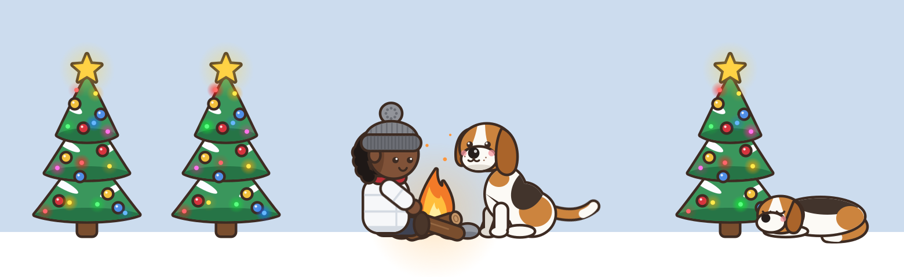

# ❄︎ WinterIsComing · Pet & Me edition ❄︎

A little snowfall for your Mac desktop, now with you and your pet living on the snow 🐶☃️

Snow drifts down and settles on your windows, the Dock and the bottom of the screen. Roll it into snowballs, stack them into a snowman, hang some fairy lights, and watch you and your pet hang out by the campfire under a twinkling Christmas tree.



This is a fork of [yike-shi/WINTER_IS_COMING](https://github.com/yike-shi/WINTER_IS_COMING), which made the snow, snowballs, snowmen and fairy lights. This edition adds the Pet & Me companions, the campfire, the Christmas tree and a few quality-of-life touches. It is Mac only; for Windows, use the original project.

## 🎁 Download

| | |
|---|---|
| **Mac** | [WinterIsComing-mac zip](https://github.com/BhargavJakku/WINTER_IS_COMING_WITH_PUPPY/releases/latest) · unzip, move it to Applications, open it |

On the release page, grab the zip with the app's name (not the "Source code" ones).

**The first time you open it**, your Mac may stop it, because the app isn't signed with a paid developer account yet: click **Done**, then go to **System Settings → Privacy & Security** and click **Open Anyway**. Just once, and you're all set.

For snow on the Dock too, allow **WinterIsComing** in **System Settings → Privacy & Security → Accessibility**.

Don't worry, the app never connects to the internet, and all of its code is right here 💙

## ✨ What you can do

**The snow** (from the original app)

- **Watch it snow**: flakes drift down in three soft layers and pile up on your windows and the ground
- **Drag a window**: the snow on top slides right off
- **Roll a snowball**: move your mouse sideways over the snow, no clicking needed
- **Push it**: roll one snowball into another and give it a nudge
- **Carry it**: hold the left mouse button on a snowball and take it anywhere
- **Build a snowman**: stack three snowballs, and he gets a carrot nose and a red scarf ⛄ (in this edition, one of six outfits at random: top hat, cozy beanie, earmuffs, Santa, backwards cap or wizard)
- **Hang fairy lights**: turn them on from the menu and watch them swing into place

**Pet & Me** (new in this edition)

- **You and your pet** walk around on the ground snow, leaving little footprints
- **Pet your pet**: click it ❤️ · click twice quickly and it howls 🎶
- **Call it over**: click yourself and your pet comes running for a cuddle
- **Fetch**: every so often you throw a snowball and your pet fetches it, and if you throw one with the mouse, it chases that too
- **Snowman trouble**: a few seconds after you finish a snowman, your pet knocks it over 😈
- **Campfire time** 🔥: now and then you both sit by the fire for a couple of minutes and your pet dozes off. Click the fire to start it right away. It melts the snow around it, and any snowball you roll into it
- **Christmas tree** 🎄: a third of your screen tall, with twinkling lights and a sparkling star
- **Naps**: leave the mouse alone for a minute and you both doze off; move it and you wake up
- **Wind moods** 🌬️: the wind drifts between a gentle breeze, a moderate wind and strong gusts. When a gust hits, you wrap up in a flapping striped scarf and your pet puts on its red knit sweater

**Little extras**

- Deeper snow on the ground, with some already there when the app starts
- An auto-hiding Dock keeps its snow and pops up already snowy, and if it pops up under you or your pet, you ride on top of it
- Smooth fading when you swipe between Spaces and full-screen apps
- **Snow Amount → None**: just you and your pet, no falling snow
- **Performance** (Battery Saver / Balanced / High Quality) and **Reduce Motion**, right in the ❄︎ menu

Everything lives in the ❄︎ menu in the menu bar: pause, snow amount, performance, reduce motion, **Pet & Me**, **Campfire**, **Christmas Tree**, fairy lights, clear snow, and how to play.

## 🔋 Light on your Mac

Made to run all day on an 8 GB laptop:

- You, your pet, the tree and the campfire are drawn once when the app starts (a few milliseconds, a few MB of memory) and then just moved around. No images, video or heavy effects
- **Performance** in the ❄︎ menu: **Battery Saver** (20 frames per second), **Balanced** (30, the default) or **High Quality** (60). Each one also sets how often the app checks where your windows are
- **Reduce Motion**: at most 30 frames per second, fewer flakes, only gentle wind, no zoomies, a calmer fire and tree
- While you nap, the frame rate halves and window checks slow down. It does the same in Low Power Mode
- Everything stops drawing while your display sleeps or the snow is paused

## 🛠️ Build it yourself

Needs `swiftc` (run `xcode-select --install` if you don't have it).

```sh
git clone https://github.com/BhargavJakku/WINTER_IS_COMING_WITH_PUPPY.git
cd WINTER_IS_COMING_WITH_PUPPY
zsh build.sh            # run it
zsh make_app.sh 1.0     # or package it as an .app (the zip in dist/ is what goes on Releases)
```

When you run it with `build.sh`, the Accessibility permission for Dock snow belongs to **Terminal**.

## 🎨 Make it yours

- **Settings**: the snow settings live at the top of `WinterIsComing.swift` (`Cfg`), and the Pet & Me settings right below the "Pet & me" heading (`Pals`): walking speeds, how long until a nap, how often you throw snowballs, how long your pet lets a snowman stand. Change a number and run it again
- **Your look and your pet's**: colors live in `PalsRecipe` (skin, hair, beanie, jacket, your pet's coat, markings, ears, saddle). An easy in-app Customize window is planned
- **The howl**: replace `assets/howl.wav` with a recording of your own pet (`howl.m4a`, `.mp3`, `.wav` or `.aiff` all work)

## 💙 Credits & License

Original WinterIsComing by [yike-shi](https://github.com/yike-shi/WINTER_IS_COMING). Pet & Me edition by [BhargavJakku](https://github.com/BhargavJakku).
Wind moods ported from, and the snowman-outfit and performance-profile ideas inspired by, [251701054/WINTER-IS-COMMING-VER2](https://github.com/251701054/WINTER-IS-COMMING-VER2) (MIT).

[MIT](LICENSE) · Made with 💙 and a little help from Claude
